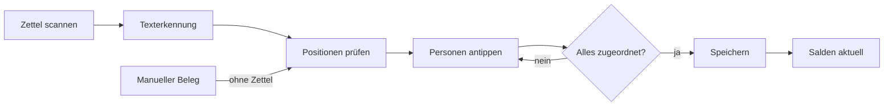
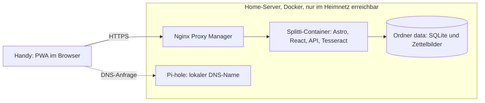

# Splitti – Plan

Stand: 12.11.2026

## Ziel und Nicht-Ziele

Splitti ist eine selbst gehostete Web-App, mit der eine Gruppe Kassenzettel scannt und jede Position per Antippen auf einzelne Mitglieder verteilt. Das Rechnen übernimmt die App, und das Zettelbild bleibt als Nachweis am Beleg.

Ziele der ersten Version:

- Kassenzettel fotografieren, Positionen lokal erkennen und als digitalen Beleg anzeigen
- Pro Position auswählen, wer sie trägt (Opt-in), und mit einem Klick speichern
- Erkannte Positionen überschreiben, ergänzen und löschen
- Manuelle Einträge ohne Zettel: ein Betrag auf bestimmte Leute, oder ein von Hand angelegter Beleg mit Positionen
- Salden pro Person und Schulden begleichen
- Mehrere Gruppen, Zugang ohne Konto über einen geheimen Link
- Als PWA auf dem Handy installierbar

Nicht-Ziele:

- Konten, Logins oder Rollen
- Zugriff von außerhalb des Heimnetzes
- Cloud-Dienste für Texterkennung oder Speicherung
- Anbindung an Bank oder PayPal
- Native Apps für iOS oder Android

Auf später verschoben: Übernahme der Daten aus der bisherigen App, Fotos unterwegs vormerken, ungleiche Anteile an einer Position und andere Währungen als Euro.

## Kernablauf

Ein gescannter und ein manuell angelegter Beleg laufen ab „Positionen prüfen“ durch dieselben Schritte. Solange eine Position niemandem zugeordnet ist, führt der Weg zurück zum Antippen.

## Screens

Die App kommt mit neun Screens aus; der Aufteilungs-Screen ist der Kern. Die Wireframes aller neun Screens liegen als HTML-Dateien in `docs/wireframes/` (Handy-Format 390 × 844). Sie legen Aufbau, Inhalte und Texte fest, nicht das endgültige Aussehen.

| Screen | Wireframe | Zweck | Wichtigste Elemente |
| --- | --- | --- | --- |
| Start | `start.html` | Gruppen auf diesem Gerät | Liste bekannter Gruppen, „Gruppe erstellen“, Beitritt über Link |
| Gruppe erstellen | `gruppe-erstellen.html` | Neue Gruppe anlegen | Gruppenname, eigener Name, weitere Mitglieder; danach öffnet sich die Gruppenübersicht |
| Wer bist du? | `wer-bist-du.html` | Gerät einem Mitglied zuordnen | Mitglied antippen oder neu anlegen; wird pro Gerät und Gruppe gemerkt |
| Gruppenübersicht | `gruppenuebersicht.html` | Stand der Gruppe | Salden aller Mitglieder, letzte Belege, „Scannen“ und „Manuell“ |
| Scan | `scan.html` | Zettel erfassen | Kamera oder Foto aus der Galerie, Hinweis „Zettel aufrecht fotografieren“, Fortschritt der Erkennung |
| Beleg aufteilen | `beleg-aufteilen.html` | Positionen zuordnen | Zettelbild, Zahler, Positionsliste mit Mitglieder-Chips, Summenprüfung, „Speichern“ |
| Manueller Eintrag | `manueller-eintrag.html` | Kosten ohne Zettel | Betrag und Leute, oder leerer Beleg mit eigenen Positionen |
| Beleg-Detail | `beleg-detail.html` | Nachvollziehen | Zettelbild, Positionen mit Anteilen, wer wann was geändert hat |
| Salden und Begleichen | `begleichen.html` | Schulden ausgleichen | Wer schuldet wem wie viel, „Zahlung eintragen“ |

Die Gruppeneinstellungen (Name, Mitglieder, Link teilen, eigene Zuordnung ändern) hängen als Unterseite an der Gruppenübersicht. „Link teilen“ öffnet das Teilen-Menü des Geräts.

## Aufteilungsregeln

Jede Position wird gleichmäßig auf die Mitglieder verteilt, die bei ihr ausgewählt sind; ohne Auswahl trägt sie niemand.

**Zuordnung (Opt-in)**

- Eine neue Position ist niemandem zugeordnet. Speichern geht erst, wenn jede Position mindestens eine Person hat oder gelöscht wurde.
- Abkürzungen gegen viele Klicks: „alle“ pro Position, und mehrere Positionen markieren und gemeinsam zuordnen.
- Der Zahler ist mit dem Mitglied dieses Geräts vorbelegt und lässt sich ändern.

**Korrektur**

- Bezeichnung und Preis jeder Position sind überschreibbar.
- Positionen lassen sich hinzufügen und löschen.

**Sonderzeilen**

- Mengenzeilen („2 * 0,99“) und Gewichtszeilen werden mit ihrem Artikel zu einer Position zusammengefasst.
- Pfand ist eine normale Position und wird wie jede andere von Hand zugeordnet.
- Ein Rabatt direkt unter einem Artikel mindert dessen Preis. Ein Rabatt auf den ganzen Einkauf wird anteilig nach Preis auf alle Positionen verteilt.
- Zeilen ohne Kostenwirkung (Mehrwertsteuer, Zahlart, Treuepunkte) werden verworfen.

**Summenprüfung**

- Die Summe der Positionen wird mit der erkannten Zettelsumme verglichen. Eine Abweichung steht sichtbar über dem Speichern-Knopf.
- Maßgeblich für die Abrechnung ist die Summe der Positionen, nicht die erkannte Zettelsumme.

**Rundung**

- Gerechnet wird in ganzen Cent.
- Pro Beleg wird für jede Person der exakte Anteil über alle Positionen summiert und erst dann gerundet. So weicht niemand um mehr als einen Cent pro Beleg ab.
- Übrige Cent gehen an die Personen mit dem größten Rundungsrest. Bei Gleichstand wechselt die Reihenfolge von Beleg zu Beleg, damit es nicht immer dieselbe Person trifft.
- Rechenbeispiel (Zettel A, 11,63 €): Nougat Pockets 2,79 auf Du und Rosi; No Milk 0,95 auf Du; Girandole 3,00 auf alle vier; Hauchgenuss 2,00 auf Du und Karl; Salami 1,00 auf Karl; Käseaufschnitt 1,89 auf Du und Karl. Exakte Anteile: Du 5,04, Karl 3,695, Rosi 2,145, vierte Person 0,75. Ergebnis: Du 5,04 und vierte Person 0,75; Karl und Rosi haben denselben Rest, einer bekommt den übrigen Cent (3,70 und 2,14 oder 3,69 und 2,15). Die Summe ist in beiden Fällen 11,63.

**Salden und Begleichen**

- Saldo einer Person = von ihr bezahlt minus ihr Anteil, über alle Belege und Zahlungen der Gruppe.
- „Begleichen“ schlägt die wenigsten Überweisungen vor, die alle Salden auf null bringen. Eine erledigte Überweisung wird als Zahlung eingetragen.

## Gruppen und Zugriff

Wer den Link einer Gruppe hat, darf in ihr alles; Konten und Rollen gibt es nicht.

- Wer eine Gruppe erstellt, gibt den Gruppennamen, den eigenen Namen und auf Wunsch die weiteren Mitglieder an; sein Gerät ist ihm damit zugeordnet. Dabei entsteht ein Link mit einem langen Zufallscode. Der Link ist der einzige Schlüssel zur Gruppe.
- Mitglieder sind Namen mit Farbe oder Bild, keine Konten. Jeder mit Link kann Mitglieder hinzufügen und entfernen.
- Wer die Gruppe über den Link öffnet, wählt beim ersten Mal seinen Namen aus der Mitgliederliste oder legt sich neu an. Das Gerät merkt sich die Wahl und belegt damit Zahler und „geändert von“ vor.
- Ein Mitglied mit bestehenden Einträgen wird beim Entfernen deaktiviert, nicht gelöscht, damit alte Belege und Salden stimmen.
- Weil jeder alles ändern darf, führt die Gruppe einen Änderungsverlauf, und gelöschte Belege lassen sich wiederherstellen.

## Datenmodell

Alles hängt an der Gruppe, und ein manueller Eintrag ist ein Beleg mit einer einzigen Position. So gibt es nur einen Rechenweg für gescannte und manuelle Kosten.

| Objekt | Wichtigste Felder | Hinweis |
| --- | --- | --- |
| Gruppe | Name, Link-Code | Wurzel aller anderen Objekte; Währung ist immer Euro |
| Mitglied | Gruppe, Name, Farbe oder Bild, aktiv | Kein Konto; „aktiv“ statt Löschen |
| Beleg | Gruppe, Zahler, Datum, Händler, erkannte Zettelsumme, Bild, Quelle (Scan oder manuell), gelöscht am | Bild fehlt bei manuellen Belegen |
| Position | Beleg, Bezeichnung, Betrag in Cent, Art (Artikel, Pfand, Rabatt), Reihenfolge | Betrag nach Abzug zugehöriger Rabatte |
| Anteil | Position, Mitglied | Ein Eintrag pro ausgewählter Person; gleiche Teile |
| Zahlung | Gruppe, von, an, Betrag in Cent, Datum | Ausgleich zwischen zwei Mitgliedern |
| Änderung | Gruppe, Mitglied, Zeitpunkt, betroffenes Objekt, Art der Änderung | Speist den Änderungsverlauf |

## Architektur und Hosting

- **Betrieb:** Ein Docker-Compose-Stack auf dem Home-Server, erreichbar über eine eigene Subdomain, die Pi-hole im Heimnetz auflöst. Es gibt keine Portfreigabe nach außen. Nginx Proxy Manager und Pi-hole existieren bereits und gehören nicht zu diesem Repo.
- **HTTPS:** Kamera und PWA-Installation funktionieren im Browser nur über HTTPS. Das Zertifikat stellt der Nginx Proxy Manager; die App selbst spricht nur HTTP.
- **Texterkennung:** Der Server (i5, 4 GB RAM, keine Grafikkarte) reicht nicht für ein lokales Bildmodell. Deshalb läuft klassische Texterkennung auf der CPU, dahinter ein Regelwerk für das Kaufland-Layout; weitere Läden kommen später als eigene Regelsätze dazu. Die Schnittstelle (Bild rein, Positionen raus) bleibt austauschbar.
- **Daten:** Eine SQLite-Datei und ein Ordner für Zettelbilder, zusammen in einem Verzeichnis.
- **PWA:** Die App ist installierbar und startet wie eine native App. Erfassen und Speichern brauchen die Verbindung zum Server.

## Technik-Stack

Splitti ist eine Astro-Anwendung mit React-Oberfläche und SQLite, die als ein Container läuft.

| Baustein | Wahl | Hinweis |
| --- | --- | --- |
| Framework | Astro im Server-Modus mit Node-Adapter | Ein Prozess liefert Seiten und API-Endpunkte |
| Oberfläche | React als eine App-Insel mit eigenem Routing | Alle neun Screens sind interaktiv; Astro liefert Hülle, Manifest und API |
| Sprache | TypeScript im strikten Modus | Gleiche Typen für Oberfläche, API und Rechenkern |
| Datenbank | SQLite mit Drizzle ORM und Migrationen | Migrationen laufen beim Start automatisch |
| Gestaltung | Tailwind CSS | Umsetzung nach den Wireframes, Texte auf Deutsch |
| Texterkennung | Tesseract mit deutschem Sprachpaket, Vorverarbeitung mit sharp | Im selben Container wie die App |
| Tests | Vitest für Rechenkern und Parser, Playwright für die Kernabläufe | Beides läuft ohne Handy und ohne Server |
| PWA | Web-App-Manifest und Service Worker für die App-Hülle | Keine Offline-Erfassung |

Geldbeträge sind überall ganze Cent, nie Kommazahlen. Welche Gruppen ein Gerät kennt und wer man darin ist, speichert der Browser, nicht die Datenbank.

## Datenbankschema

Sieben Tabellen bilden das Datenmodell ab; gelöscht wird nur über einen Zeitstempel, damit sich Belege wiederherstellen lassen.

| Tabelle | Spalten |
| --- | --- |
| groups | id, name, token (eindeutig), created_at |
| members | id, group_id, name, color, active, created_at |
| receipts | id, group_id, paid_by, date, merchant, detected_total_cents, image_path, source (scan oder manual), created_by, created_at, deleted_at |
| items | id, receipt_id, label, amount_cents, kind (item, deposit, discount), position |
| shares | item_id, member_id (zusammen der Schlüssel) |
| payments | id, group_id, from_member, to_member, amount_cents, date, created_by, created_at, deleted_at |
| changes | id, group_id, member_id, at, entity, entity_id, action, summary |

## API

Jeder Endpunkt hängt unter dem Link-Code der Gruppe; der Code im Pfad ist die einzige Berechtigung.

| Methode und Pfad | Zweck |
| --- | --- |
| POST /api/groups | Gruppe mit Name, eigenem Namen und Mitgliedern anlegen; liefert den Link-Code |
| GET /api/groups/:token | Gruppe, Mitglieder und Salden |
| PATCH /api/groups/:token | Gruppe umbenennen |
| POST /api/groups/:token/members | Mitglied hinzufügen |
| PATCH /api/groups/:token/members/:id | Mitglied umbenennen oder deaktivieren |
| POST /api/groups/:token/scan | Zettelbild hochladen; liefert erkannte Positionen als Entwurf, speichert noch keinen Beleg |
| GET /api/groups/:token/receipts | Belege der Gruppe |
| POST /api/groups/:token/receipts | Beleg mit Positionen und Anteilen speichern |
| GET /api/groups/:token/receipts/:id | Beleg mit Positionen, Anteilen und Verlauf |
| PUT /api/groups/:token/receipts/:id | Beleg ändern |
| DELETE /api/groups/:token/receipts/:id | Beleg löschen (wiederherstellbar) |
| POST /api/groups/:token/receipts/:id/restore | Beleg wiederherstellen |
| GET /api/groups/:token/receipts/:id/image | Zettelbild |
| GET /api/groups/:token/settlement | Vorschlag der Überweisungen |
| POST /api/groups/:token/payments | Zahlung eintragen |
| DELETE /api/groups/:token/payments/:id | Zahlung löschen |
| GET /api/groups/:token/changes | Änderungsverlauf |
| GET /api/health | Lebenszeichen für Docker |

Der Server prüft bei jedem Speichern, dass jede Position mindestens einen Anteil hat, alle Beträge ganze Cent sind und alle Mitglieder zur Gruppe gehören.

## Texterkennung im Detail

Die Erkennung besteht aus zwei getrennten Teilen: Bild zu Textzeilen, und Textzeilen zu Positionen. Der zweite Teil ist reine Logik und wird gegen die Testzettel geprüft.

1. **Vorverarbeitung:** Bild annehmen (JPEG oder PNG), Kamera-Drehung aus den Bilddaten anwenden, lange Seite auf etwa 2000 Pixel bringen, in Graustufen wandeln, Kontrast normalisieren.
2. **Texterkennung:** Tesseract liefert Wörter mit Position, daraus entstehen Zeilen mit Text links und Betrag rechts.
3. **Kaufland-Parser:** Der Artikelblock beginnt nach „Preis EUR“ und endet bei „Summe“. Eine Artikelzeile ist Text, Betrag und Kennzeichen A oder B. Eine Mengen- oder Gewichtszeile gehört zum Namen darüber und trägt den Preis. „Pfandartikel“ wird als Pfand markiert.
4. **Prüfwerte:** Zettelsumme und Steuertabelle werden gelesen und mit der Summe der Positionen verglichen.
5. **Rückfall:** Wird nichts Brauchbares erkannt, öffnet sich ein leerer Beleg mit dem Bild, und die Positionen werden von Hand eingetragen.

Scan-Bedingung für die erste Version: Der Zettel wird aufrecht fotografiert, automatisches Drehen über die Kamera-Drehung hinaus entfällt. Zerknitterte Zettel und Schatten muss die Erkennung aushalten.

## Betrieb und Updates

Installation und Update sind je ein Befehl im Repo-Ordner, und die Daten überleben jedes Update.

- **Installation:** Repo in den Home-Ordner klonen, in den Ordner wechseln, `docker compose up -d --build`.
- **Update:** `git pull`, danach wieder `docker compose up -d --build`. Ein `docker compose down` davor ist nicht nötig, darf aber nichts kaputt machen.
- **Daten:** Datenbank und Zettelbilder liegen im Ordner `data` im Repo-Verzeichnis, der in den Container eingehängt und von Git ausgenommen ist. Der Ordner überlebt Updates und `down`; eine Sicherung ist eine Kopie dieses Ordners.
- **Dauerbetrieb:** Der Container läuft im Hintergrund und startet nach einem Neustart des Servers von selbst (`restart: unless-stopped`).
- **Einstellungen:** Der Port steht in einer `.env`-Datei; der Nginx Proxy Manager zeigt auf diesen Port.
- **Proxy-Netzwerk:** Die Compose-Datei enthält eine vorbereitete, auskommentierte Stelle für das externe Docker-Netzwerk des Nginx Proxy Managers, in die nur noch der Netzwerkname eingetragen wird. Vorlage: `docs/compose.vorlage.yaml`.

## Meilensteine

Sieben Meilensteine in fester Reihenfolge; jeder ist erst fertig, wenn seine Abnahme automatisch grün ist.

| Nr. | Meilenstein | Inhalt | Abnahme |
| --- | --- | --- | --- |
| 1 | Gerüst | Astro, React, SQLite, Dockerfile, Compose-Datei, Tests und Build in GitHub Actions | `docker compose up` startet, `/api/health` antwortet, Tests laufen |
| 2 | Texterkennung | Vorverarbeitung, Tesseract, Kaufland-Parser | Parser liefert für die drei Text-Vorlagen genau die erwarteten Positionen; Ergebnis an den echten Fotos steht als Bericht im Repo |
| 3 | Rechenkern | Aufteilung, Rundung, Salden, Begleichen als reine Funktionen | Tests: Summe der Anteile gleich Belegsumme, Abweichung höchstens ein Cent pro Person, Salden ergeben zusammen null, Begleichen bringt alle auf null, Rechenbeispiel Zettel A stimmt |
| 4 | Gruppen | API und Screens Start, Gruppe erstellen, Wer bist du?, Einstellungen | Browser-Test: Gruppe anlegen, Link öffnen, Mitglied wählen |
| 5 | Belege | Scan, Beleg aufteilen, manueller Eintrag, Beleg-Detail, Verlauf, Löschen und Wiederherstellen | Browser-Test: Testzettel hochladen, zuordnen, speichern, ändern, löschen, wiederherstellen |
| 6 | Salden | Gruppenübersicht, Begleichen, Zahlungen | Browser-Test: Salden stimmen nach zwei Belegen und einer Zahlung |
| 7 | PWA und Abschluss | Manifest, Service Worker, Icons, Bedienung am Handy-Format, Betriebsanleitung | Installierbarkeit geprüft, alle Tests grün, Anleitung für Installation und Update im README |

## Arbeitsregeln für Claude Code

Claude Code arbeitet die Meilensteine ohne Rückfrage der Reihe nach durch, bis die App fertig ist. Wird eine Abnahme nicht grün, probiert es weitere Lösungswege und hält erst an, wenn es wirklich nicht weiterkommt.

- Pro Meilenstein umsetzen, Tests grün, auf den Hauptzweig committen. Issues sind freiwillig.
- Bei einer Lücke im Plan die naheliegendste Lösung wählen und sie mit Begründung in `docs/DECISIONS.md` notieren.
- Kein Meilenstein gilt mit roten Tests als fertig; Tests werden nicht abgeschwächt, um grün zu werden.
- Nichts außerhalb des Plans bauen: keine Konten, kein Zugriff von außen, keine Cloud-Dienste.
- Am Ende ein Bericht, was sich nicht automatisch prüfen ließ: Kamera am echten Handy, HTTPS über den Proxy, Erkennung an neuen Zetteln.

## Testzettel

Drei Kaufland-Zettel dienen als Testmaterial; bei allen dreien ergeben die erwarteten Positionen genau die Zettelsumme. Die Dateien liegen in `tests/fixtures/receipts/`:

- `kaufland-a.jpg`, `kaufland-b.jpg`, `kaufland-c.jpg`: die Fotos, aufrecht gedreht
- `kaufland-a.txt` usw.: die Zeilen des Zettels von Hand abgetippt, als Vorlage für Parser-Tests
- `kaufland-a.expected.json` usw.: das erwartete Ergebnis

Die Fotos B und C tragen Textmarker und Handschrift. Das ist kein Anwendungsfall, denn im Betrieb werden unmarkierte Zettel gescannt. Weicht die Erkennung an diesen beiden Fotos nur an markierten Stellen ab, gilt das nicht als Fehler; es wird im Bericht vermerkt.

Was die Zettel über das Layout zeigen:

- **Artikelblock:** Jede Artikelzeile endet mit Preis und Steuerkennzeichen (A oder B). Der Block endet an der Zeile „Summe“; Zahlart, Steuertabelle und Kartendaten darunter werden verworfen.
- **Menge:** Bei „3 * 1,00“ steht der Artikelname ohne Preis in der Zeile darüber, der Gesamtpreis in der Mengenzeile.
- **Gewicht:** „0,440 kg“ steht ebenfalls unter dem Artikelnamen und trägt den Preis.
- **Pfand:** „Pfandartikel“ folgt direkt auf das Getränk, bei mehreren Flaschen mit Menge in derselben Zeile („2 * 0,25“).
- **Zweite Prüfung:** Die Brutto-Beträge der Steuertabelle ergeben zusammen die Zettelsumme und je Kennzeichen die Summe der passenden Artikel.

Erwartetes Ergebnis der Erkennung:

| Zettel | Position | Betrag (€) |
| --- | --- | --- |
| A · Summe 11,63 | KLC.Nougat Pockets | 2,79 |
| A | KVeg.No Milk | 0,95 |
| A | Barilla Girandole (3 × 1,00) | 3,00 |
| A | Hauchgenuss vegan (2 × 1,00) | 2,00 |
| A | Salami vegan | 1,00 |
| A | KLC.Käseaufschnitt | 1,89 |
| B · 27.10.2026 · Summe 30,22 | KLC.Nougat Pockets | 2,79 |
| B | Ofenfr.Rucolapesto | 1,79 |
| B | Tradizion.Margher. | 1,79 |
| B | Paul. Spezi Zero | 0,95 |
| B | Pfandartikel | 0,25 |
| B | Iglo Brokkoli | 2,79 |
| B | Red Bull Energy (2 × 0,88) | 1,76 |
| B | Pfandartikel (2 × 0,25) | 0,50 |
| B | KVeg.No Milk | 0,95 |
| B | Rotbusch Sahne-Ka. | 2,49 |
| B | Maultaschen vegan | 2,29 |
| B | Kartoffeln 2,5kg | 3,79 |
| B | Kveg. Tofu Natur | 2,29 |
| B | Gelbstecker 10 st. | 5,79 |
| C · 09.11.2026 · Summe 28,29 | KLC.Käseaufschnitt | 1,89 |
| C | KLC TaTü 4lg 15x10 | 1,75 |
| C | KLC.Backpapier | 0,79 |
| C | Teek.Türk.Apfel | 1,19 |
| C | Teek.Strawb.Chees. | 2,49 |
| C | K.Sandwichtoast VK | 2,49 |
| C | Ostm.Knoblauch | 2,29 |
| C | KLC Vollwaschm. | 4,25 |
| C | Meggle Die Vegane | 2,09 |
| C | Barilla Pesto Ros. (3 × 1,88) | 5,64 |
| C | Ba.Pesto getr.Tom. | 1,88 |
| C | Äpfel Pink Lady (0,440 kg) | 1,54 |

## Entscheidungen

| Frage | Entscheidung |
| --- | --- |
| Server-Hardware | i5, 4 GB RAM, keine Grafikkarte: klassische Texterkennung auf der CPU |
| Läden | Kaufland zuerst |
| Ungleiche Anteile | Nein, immer gleiche Teile |
| Foto unterwegs vormerken | Nicht in der ersten Version |
| Währung | Nur Euro |
| Daten aus der bisherigen App | Ja, nach der ersten Version |
| Name | Splitti |
| Framework | Astro mit React |
| Arbeitsweise | Durcharbeiten bis fertig, Commits auf den Hauptzweig, Issues freiwillig |

Noch ohne Testmaterial: Zettel mit Rabatt- oder Couponzeile und Zettel aus anderen Läden. Die Rabattregeln werden deshalb nur mit erfundenen Text-Vorlagen getestet.
